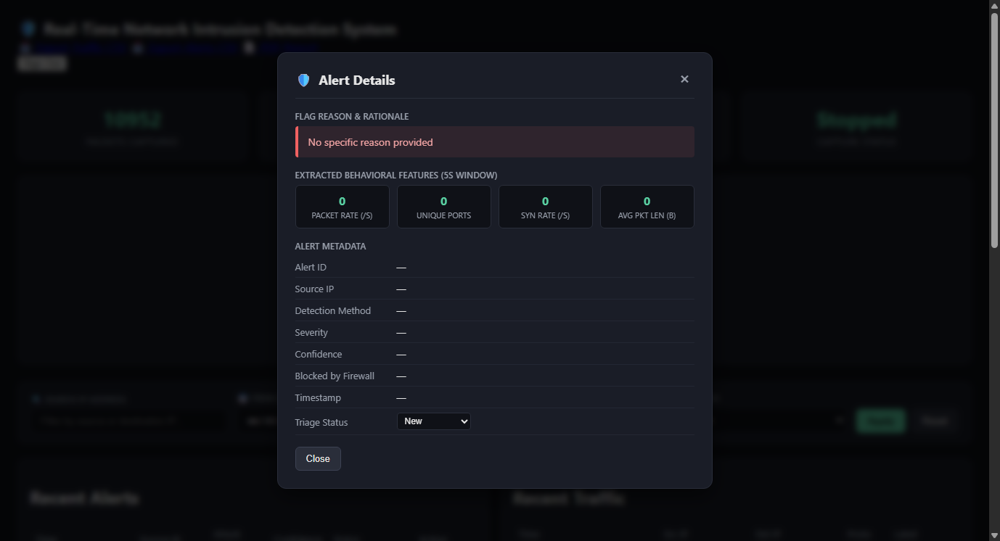
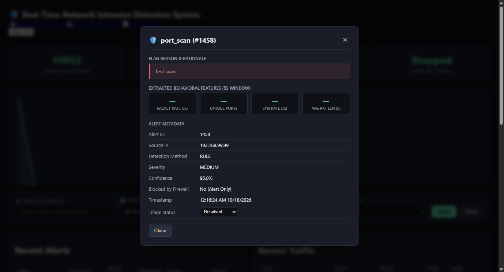

# Real-Time Network Intrusion Detection System (NIDS)

A production-grade Python-based Network Intrusion Detection System that captures network packets in real time, extracts behavioral flow features, classifies traffic with machine learning and explainable safety rules, visualizes telemetry on an interactive web dashboard, supports alert triage workflows, and provides controlled temporary firewall auto-blocking with high-severity email notifications.

---

## Key Features

- **Live Capture & PCAP Support:** Shared behavioral feature extractor (`features.py`) supporting both live packet capture (`sniffer.py`) and offline dataset/PCAP analysis (`pcap_analyzer.py`).
- **Network Interface Selection:** Inspect available adapters with `--list-interfaces` (with human-readable names on Windows/Linux) and select capture targets with `--iface`.
- **Hybrid Detection Engine:** Explainable rule fallbacks (SYN flood, port scan) layered with local Random Forest machine learning models (`ml_model.py` and `train_model.py`).
- **Interactive Web Dashboard:** Real-time throughput graph, live packet/alert counters, and cross-process capture status indicators (`running`, `stopped`, `error`).
- **Alert Triage & Inspection:**
  - **Flagging Rationale:** Modal dialog detailing why traffic was flagged, along with exact behavioral metrics (`packet_rate`, `unique_ports`, `syn_rate`, `avg_packet_len`).
  - **Triage Workflow:** Mark alerts as **New**, **Investigating**, or **Resolved** directly from the UI or REST API.
  - **Search & Filter:** Filter traffic and alerts by IP address, date ranges, and triage statuses with pagination controls.
- **Controlled Temporary Firewall Auto-Blocking:**
  - Native OS firewall integration (`iptables` on Linux, `netsh advfirewall` on Windows).
  - Accurate failure reporting with audit trail (no simulated success on permission failures).
  - Configurable lease times (default: 300s) with automatic scheduled unblocking.
- **High-Severity Email Notifications:**
  - Automated HTML & plain-text email alerts for critical attacks.
  - Per-source-IP cooldown timers (default: 300s) to prevent notification flooding.
- **Comprehensive Test Suite:** 20+ unit and integration tests covering extraction, ML inference, API endpoints, firewall mechanics, and notification logic.

---

## Screenshots

### Live Monitoring Dashboard


### Alert Details & Behavioral Metrics Modal


---

## Project Structure

```
nids_project/
├── app.py                  # Flask web dashboard, REST APIs, and admin CLI
├── sniffer.py               # Live packet capture engine (scapy) with interface selector
├── features.py              # Shared behavioral sliding-window feature extractor
├── pcap_analyzer.py         # Offline PCAP processor and dataset exporter
├── train_model.py           # ML model training script (NSL-KDD dataset)
├── ml_model.py              # Model loader and rule-based prediction fallback engine
├── take_screenshots.py      # Automated headless screenshot generator
├── utils/
│   ├── firewall.py          # Controlled temporary firewall auto-blocking & unblocking
│   ├── logger.py            # SQLite database schema, migrations, queries, and audit logs
│   └── notifications.py     # High-severity email notifications with per-IP cooldown
├── templates/
│   ├── index.html           # Real-time dashboard with search, filters, pagination & modal
│   └── login.html           # Secure CSRF-protected admin login page
├── static/
│   ├── js/dashboard.js      # Frontend polling, charts, filters, modal, and status updates
│   └── css/style.css        # Clean dark-mode interface styling
├── tests/                   # Automated test suite
│   ├── test_features.py     # Feature extraction unit tests
│   ├── test_ml_model.py     # Model inference and safety rules tests
│   ├── test_firewall.py     # IP validation, temporary leasing & audit tests
│   ├── test_notifications.py# Email formatting, cooldown & mock dispatch tests
│   └── test_app.py          # Flask authentication, CSRF, triage API & pagination tests
├── screenshots/             # Interface screenshots
├── requirements.txt         # Project dependencies
└── README.md
```

---

## Quick Start & Setup

### 1. Prerequisites
- **Python 3.10+**
- **Windows:** Install [Npcap](https://npcap.com/) (select "Install Npcap in WinPcap API-compatible Mode"). Run command prompt / PowerShell as **Administrator** for live packet capture and firewall manipulation.
- **Linux:** Install `libpcap` and `iptables`:
  ```bash
  sudo apt update && sudo apt install -y libpcap-dev iptables
  ```

### 2. Environment Setup
```bash
# Clone the repository
git clone https://github.com/AbhishekBRajpurohit/network_intrusion_detection_system.git
cd network_intrusion_detection_system

# Create and activate virtual environment
python -m venv .venv

# Windows (PowerShell):
.\.venv\Scripts\Activate.ps1
# Linux / macOS:
source .venv/bin/activate

# Install dependencies
pip install -r requirements.txt
```

### 3. Create Dashboard Admin Account
```bash
flask --app app create-admin
# Enter your chosen username and secure password (minimum 12 characters)
```

### 4. Optional: Configure Environment Variables
You can configure options in your shell or a `.env` file:
```bash
# Security & Secret Key
export NIDS_SECRET_KEY="your-random-32-byte-hex-key"

# Temporary Firewall Auto-Block Duration (seconds)
export NIDS_BLOCK_DURATION=300

# High-Severity Email Alerts (Disabled by default)
export ALERT_EMAIL_ENABLED=1
export SMTP_HOST="smtp.example.com"
export SMTP_PORT=587
export SMTP_USER="alerts@example.com"
export SMTP_PASS="your-smtp-password"
export SMTP_USE_TLS=1
export ALERT_EMAIL_TO="security-team@example.com"
export ALERT_EMAIL_FROM="nids-alerts@example.com"
export EMAIL_COOLDOWN_SECONDS=300
```

---

## Running the System

### Step 1: Start the Web Dashboard
```bash
python app.py
```
Open **http://127.0.0.1:5000** in your browser and sign in with the admin credentials created earlier.

### Step 2: Start Packet Capture
In a separate terminal (elevated as Administrator / root):

```bash
# 1. View available network interfaces
python sniffer.py --list-interfaces

# 2. Start capturing on your selected interface
# Windows example:
python sniffer.py --iface "Wi-Fi"

# Linux example:
sudo python sniffer.py --iface eth0
```
The web dashboard status card will update to **Running (`<interface>`)** with live packet metrics.

---

## Model Training & Offline PCAP Analysis

### Training the Classifier
Download `KDDTrain+.csv` from the [NSL-KDD dataset](https://www.unb.ca/cic/datasets/nsl.html), place it in `data/KDDTrain+.csv`, and run:
```bash
python train_model.py
```
This trains a Random Forest model and saves a validated bundle (`models/nids_model.pkl`) containing the required feature schema and window configuration.

### Analyzing PCAP Files Offline
```bash
# Export labelled feature vectors from a PCAP recording
python pcap_analyzer.py samples/attack.pcap --output data/extracted.csv --label port_scan --session sess_001

# Inspect an unlabelled capture through the model
python pcap_analyzer.py samples/traffic.pcap --output data/predictions.jsonl
```

---

## Running the Test Suite

Run all unit and integration tests with Python's built-in test runner:
```bash
python -m unittest discover tests
```

---

## Security & Ethics Notice

This tool is designed strictly for defensive monitoring, research, and educational purposes on systems you own or have explicit authorization to inspect. Do not deploy or execute attack simulations on unapproved networks.
